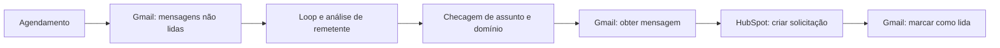
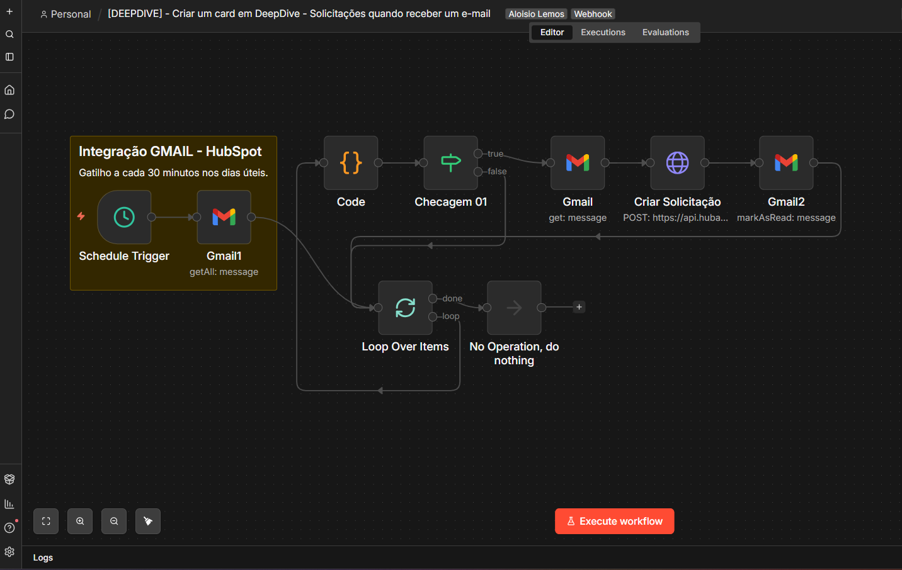

# Solicitações por e-mail — Gmail → HubSpot

Desenvolvi esta automação com **n8n, Gmail e API do HubSpot** para transformar e-mails de solicitação em cards no fluxo DeepDive e antecipar a organização das demandas que eu precisava tratar.

## O problema e a entrega

As solicitações chegavam por e-mail e precisavam ser registradas para acompanhamento. Automatizei a leitura, a checagem de remetente e assunto, a criação da solicitação e a marcação da mensagem como lida. Isso me ajudava a iniciar as tratativas e responder ao cliente com mais agilidade, sem medir aqui uma economia de tempo específica.

O projeto foi **descontinuado** quando deixamos o HubSpot e migramos o acompanhamento para outros sistemas, incluindo Microsoft Planner. A publicação documenta a solução histórica.

## Fluxo

O diagrama resume as responsabilidades; o template preserva as conexões do export. A rotina usa consulta agendada, não um webhook de recebimento imediato.

O cron recebido é **0,30 8-18 * * 1-5**: horários de meia em meia hora, entre 08:00 e 18:30 nos dias úteis, conforme o fuso configurado na instância. O export não informa esse fuso.

## Screenshot

## Material disponível

- [Template inativo de 10 nós](workflows/workflow.template.json)
- [Regras de seleção e processamento](docs/processamento.md)
- [Inventário e código](docs/inventario.md)
- [Configuração](docs/configuracao.md)
- [Preparação pública](docs/publicacao.md)
- [Validação](docs/validacao.md)

Credenciais, mensagens reais e IDs do ambiente não acompanham o template. Não foram feitas operações no Gmail ou HubSpot nesta preparação.
